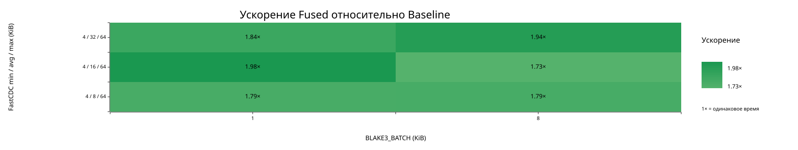

# Sweep FastCDC 4/avg/64 KiB и BLAKE3 batch

Свежие замеры на тестовом изображении (22 022 007 байт): один release-бинарник, 50 итераций, `perf stat -r 5`; FastCDC min/max = 4/64 KiB. Для каждого среднего размера проверены batch 1 и 8 KiB. В baseline batch игнорируется алгоритмом, но измерения оставлены парными по ячейкам.

## Heatmap

Это heatmap ускорения по времени, построенная штатным режимом приложения `--mode build-graph`. В ячейке показано отношение elapsed time baseline к fused: значение 1,98× означает, что fused обработал данные примерно в 1,98 раза быстрее в этой конфигурации. Приложение строит график из `results.txt` и `results_baseline.txt`, лежащих рядом с этой сводкой.

## Сравнение по конфигурациям

| Avg chunk | Batch | Baseline, с | Fused, с | Wall-clock speedup | Cycles baseline → fused | Cycle ratio | Instructions baseline → fused | Изменение instructions | Cache misses baseline → fused | Снижение cache misses |
|---:|---:|---:|---:|---:|---:|---:|---:|---:|---:|---:|
| 8 KiB | 1 KiB | 2.755 ± 0.010 | 1.541 ± 0.004 | 1.79× | 3 298 211 643 → 2 942 892 539 | 1.121× | 8 361 484 524 → 8 626 983 162 | +3.18% | 19 309 882 → 6 181 809 | 68.0%
| 8 KiB | 8 KiB | 2.769 ± 0.011 | 1.548 ± 0.006 | 1.79× | 3 313 560 469 → 2 948 688 354 | 1.124× | 8 361 483 057 → 8 626 982 202 | +3.18% | 19 105 148 → 6 253 891 | 67.3%
| 16 KiB | 1 KiB | 2.863 ± 0.202 | 1.443 ± 0.008 | 1.98× | 3 081 443 609 → 2 747 738 550 | 1.121× | 8 635 867 828 → 8 801 485 539 | +1.92% | 18 071 568 → 4 983 586 | 72.4%
| 16 KiB | 8 KiB | 2.456 ± 0.006 | 1.418 ± 0.001 | 1.73× | 3 008 231 469 → 2 711 722 378 | 1.109× | 8 635 865 662 → 8 801 484 959 | +1.92% | 17 581 335 → 4 729 576 | 73.1%
| 32 KiB | 1 KiB | 2.507 ± 0.014 | 1.360 ± 0.009 | 1.84× | 2 869 982 517 → 2 576 681 108 | 1.114× | 8 740 849 049 → 8 835 686 576 | +1.08% | 16 961 750 → 4 437 965 | 73.8%
| 32 KiB | 8 KiB | 2.596 ± 0.007 | 1.340 ± 0.005 | 1.94× | 2 965 114 548 → 2 558 612 164 | 1.159× | 8 740 848 055 → 8 835 692 614 | +1.09% | 17 438 250 → 3 933 554 | 77.4%

## Все счётчики `perf stat`

| Avg chunk | Batch | Режим | Время, с (± разброс) | Cycles (± разброс) | Instructions (± разброс) | Cache references (± разброс) | Cache misses (± разброс) |
|---:|---:|---|---:|---:|---:|---:|---:|
| 8 KiB | 1 KiB | baseline | 2.755 ± 0.010 (±0.37%) | 3 298 211 643 (±0.33%) | 8 361 484 524 (±0.00%) | 320 605 132 (±0.36%) | 19 309 882 (±0.49%)
| 8 KiB | 1 KiB | fused | 1.541 ± 0.004 (±0.24%) | 2 942 892 539 (±0.32%) | 8 626 983 162 (±0.00%) | 283 482 280 (±0.76%) | 6 181 809 (±0.71%)
| 8 KiB | 8 KiB | baseline | 2.769 ± 0.011 (±0.39%) | 3 313 560 469 (±0.49%) | 8 361 483 057 (±0.00%) | 329 299 484 (±1.74%) | 19 105 148 (±0.53%)
| 8 KiB | 8 KiB | fused | 1.548 ± 0.006 (±0.40%) | 2 948 688 354 (±0.24%) | 8 626 982 202 (±0.00%) | 283 113 380 (±0.76%) | 6 253 891 (±1.13%)
| 16 KiB | 1 KiB | baseline | 2.863 ± 0.202 (±7.06%) | 3 081 443 609 (±0.41%) | 8 635 867 828 (±0.00%) | 260 379 754 (±0.20%) | 18 071 568 (±0.77%)
| 16 KiB | 1 KiB | fused | 1.443 ± 0.008 (±0.53%) | 2 747 738 550 (±0.45%) | 8 801 485 539 (±0.00%) | 233 069 284 (±1.78%) | 4 983 586 (±0.96%)
| 16 KiB | 8 KiB | baseline | 2.456 ± 0.006 (±0.23%) | 3 008 231 469 (±0.17%) | 8 635 865 662 (±0.00%) | 260 798 051 (±0.31%) | 17 581 335 (±0.42%)
| 16 KiB | 8 KiB | fused | 1.418 ± 0.001 (±0.08%) | 2 711 722 378 (±0.11%) | 8 801 484 959 (±0.00%) | 221 919 839 (±0.58%) | 4 729 576 (±0.85%)
| 32 KiB | 1 KiB | baseline | 2.507 ± 0.014 (±0.56%) | 2 869 982 517 (±0.55%) | 8 740 849 049 (±0.00%) | 194 942 393 (±1.06%) | 16 961 750 (±0.54%)
| 32 KiB | 1 KiB | fused | 1.360 ± 0.009 (±0.70%) | 2 576 681 108 (±0.41%) | 8 835 686 576 (±0.00%) | 188 499 699 (±0.50%) | 4 437 965 (±3.98%)
| 32 KiB | 8 KiB | baseline | 2.596 ± 0.007 (±0.27%) | 2 965 114 548 (±0.26%) | 8 740 848 055 (±0.00%) | 192 748 521 (±0.48%) | 17 438 250 (±1.02%)
| 32 KiB | 8 KiB | fused | 1.340 ± 0.005 (±0.40%) | 2 558 612 164 (±0.34%) | 8 835 692 614 (±0.00%) | 187 996 290 (±0.26%) | 3 933 554 (±2.06%)

Разброс `perf stat` — относительный показатель из вывода по пяти запускам; для времени дополнительно указано абсолютное стандартное отклонение в секундах.

## Данные и логи

- Табличные данные: [`perf-r5-sweep-4-64.csv`](perf-r5-sweep-4-64.csv)
- По каждому режиму и конфигурации сохранён отдельный полный лог `perf stat -r 5` в этой папке (`perf-r5-*.txt`).

Для слайда сравнивать следует одинаковые FastCDC avg и batch. Ускорение на heatmap рассчитано по среднему elapsed time из пяти повторов `perf stat`; счётчики cycles, instructions и кэша приведены отдельно в таблицах.
